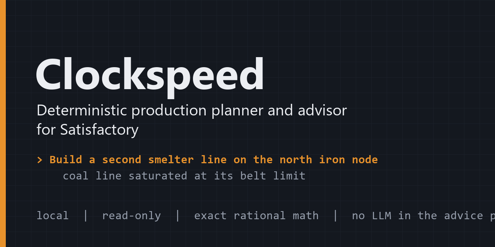
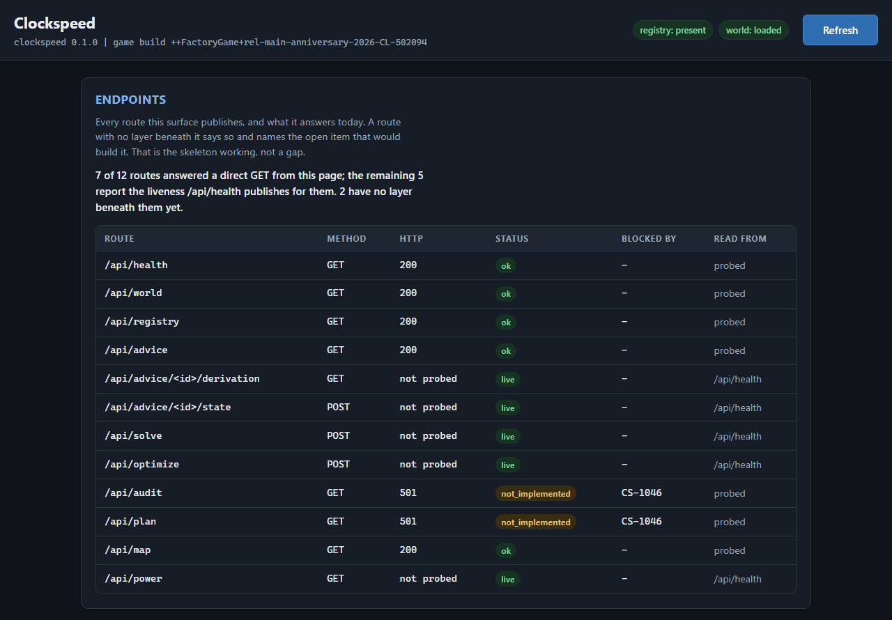

# Clockspeed



**A local, deterministic production planner, ratio calculator and advisor for Satisfactory.**

[](https://github.com/Remus3/ClockSpeed/actions/workflows/tier1.yml)
[](https://github.com/Remus3/ClockSpeed/actions/workflows/tier2.yml)
[](https://github.com/Remus3/ClockSpeed/releases)
[](pyproject.toml)
[](LICENSE)


Status: v0.1.0 - early 0.x, Windows only. The HTTP API may change between 0.x releases.

## Contents

- [What and why](#what-and-why)
- [At a glance](#at-a-glance)
- [Requirements](#requirements)
- [Get the code](#get-the-code)
- [Quickstart](#quickstart)
- [First result](#first-result)
- [Usage](#usage)
- [Architecture and layout](#architecture-and-layout)
- [Development and tests](#development-and-tests)
- [License](#license)

## What and why

Clockspeed reads the data files your own installation ships with and your own save file,
computes exact production mathematics, and tells you what to build next - one line of
instruction, one line of reason, and the full derivation on request.

It carries no item, recipe or building dataset of its own: every fact comes out of your
install at runtime, so a patch that changes a recipe changes the answer, where a
hand-maintained wiki table drifts. Ratios are solved in exact rational arithmetic, so a
fractional building count is reported exactly, and every recommendation is reproducible
from the same inputs - two runs on one save that disagree are a bug.



*The dashboard's Endpoints panel, which lists every route and what it answers today.*

## At a glance

| Property | |
|---|---|
| **Runs** | Entirely on your machine. No account, no API key, no external network service; the dashboard listens on loopback only. |
| **Reads** | Your game install and your newest save, both found automatically. |
| **Writes** | Never to the game install and never to a save file. Its own files - such as the work-directory copy of a save, the advice ledger and the local dashboard certificate - stay in its own data locations, by default under the repository and gitignored. |
| **Language models** | None, anywhere in the advice path. |
| **Not a mod** | Nothing is installed into the game, and the game process is never injected into, hooked or read from memory. |
| **Interface** | A local HTTPS dashboard, plus an optional Electron companion window. |

Game data, extracted assets and save files are never redistributed or committed here, and
the test suite runs on hand-written synthetic data with no game installed. Save headers
carry personal data, so the parser withholds the save name, options string and session
name unless a call opts in explicitly.

## Requirements

| Component | Needs |
|---|---|
| **OS** | Windows |
| **Game** | A local installation, kept current |
| **Python** | 3.13 or 3.14 - take the newest 3.14.x, not python.org's newest release when that is newer. The range is `requires-python` in [`pyproject.toml`](pyproject.toml); `scripts/verify_env.py` asserts its floor and prints the version it found |
| **git** | Git for Windows |
| **openssl** | For `scripts/make_cert.py`, and for the test suite. Git for Windows ships one, but not on PATH by default - [`docs/OPERATIONS.md`](docs/OPERATIONS.md#12-install-and-run-from-scratch) section 1.2 says how to add it; the suite needs more of Git's tools on PATH, as section 2 there states. `scripts/verify_env.py` reports it as SOFT |
| **Python packages** | The `dev` extra in `pyproject.toml`, installed by the Quickstart. Of it, `pytest` and `ruff` are the two `scripts/verify_env.py` counts as HARD |
| **Node** | For the optional companion window, and to run the full test suite - without Node the dashboard panel tests fail rather than skip. Running Clockspeed itself does not need it |

## Get the code

```
git clone https://github.com/Remus3/ClockSpeed.git
cd ClockSpeed
```

## Quickstart

From the root of a clone, in PowerShell - [`docs/OPERATIONS.md` 1.2](docs/OPERATIONS.md#12-install-and-run-from-scratch) has the full procedure, the `cmd` forms and where `<Git install>` is, and 1.3 the step to take before your first push:

```
python -m venv .venv
Set-ExecutionPolicy -Scope Process -ExecutionPolicy RemoteSigned -Force
.venv\Scripts\activate
python -m pip install -e ".[dev]"
$env:Path += ";<Git install>\usr\bin"
```

```
python scripts/install_hooks.py
python scripts/verify_env.py
python scripts/make_cert.py
python -m clockspeed.surface
```

## First result

Open `https://localhost:<port>/`, where `<port>` is the `allocations` entry in
`config/ports.json` that `scripts/verify_env.py` prints. The certificate is self-signed and
your system does not trust it, so the browser shows a certificate warning to accept before
the page titled "Clockspeed dashboard" loads. `https://localhost:<port>/api/health` answers
a compact JSON object whose top-level `status` field is `ok`.

## Usage

`python -m clockspeed.surface` serves the dashboard and a JSON API on the port above. With
no arguments it finds the newest save on this machine and serves it; `--port`,
`--cert-dir` and `--no-world` override that (`python -m clockspeed.surface --help`, and
[`docs/OPERATIONS.md`](docs/OPERATIONS.md#72-start-it) section 7.2). The optional Electron
companion window loads the running dashboard:
[`docs/OPERATIONS.md`](docs/OPERATIONS.md#8-runbook-the-companion-window) section 8.

`/api/health` reports the live route table and what is wired to it, and is the
authoritative answer to "what works today". The default branch can be ahead of the v0.1.0
release; the dashboard's advice panel is one such addition. At the head of the default branch:

- **Target-rate ratio solve** (`/api/solve`). Ask for an output per minute and get the
  whole production tree: every intermediate, exact building counts, byproduct handling and
  raw input totals. A worked request is in
  [`docs/OPERATIONS.md`](docs/OPERATIONS.md#12-install-and-run-from-scratch) section 1.2.
- **Alternate recipe selection** (`/api/optimize`). Pick the recipe set that minimizes raw
  resource use, power draw or building count over the recipe set you declare available;
  any other objective is refused rather than quietly ignored. The available set is a
  parameter of the request, not read from your save.
- **Power and clock speed mathematics** (`/api/power`). Overclock and underclock cost
  curves, including variable-power buildings whose draw is a bounded range.
- **Your world, read** (`/api/world`, `/api/registry`). Header facts, world inventory
  counts and the normalized item and recipe registry.
- **A map of what you have built** (`/api/map`). Placements with exact translation,
  rotation and scale, read straight from the save file.
- **Advice cards** (`/api/advice`). Each card has a headline, a one-line reason and a full
  derivation generated from the rule trace, plus a per-world card state that a request
  without the dashboard's same-origin proof is refused with 403. The rules so far cover
  power headroom, fuel and a stated target's plan, and the dashboard's advice panel draws
  the cards. Without a save or a game install it answers 503.

**Built, not yet published.** The whole-world audit (idle and starved machines, overclock
waste, belt and pipe saturation, power headroom, under-extracted nodes) is written and
tested, and the advice cards already read its power balance; `/api/audit` and `/api/plan`
answer a documented 501 naming the work item that publishes them. Milestone routing and
the other advice domains are next: [`docs/ARCHITECTURE.md`](docs/ARCHITECTURE.md#4-the-five-pillars-and-their-packages)
section 4.

## Architecture and layout

```
 your game install            your save file (copied first, never opened in place)
        |                                |
  clockspeed/data/                clockspeed/save/
  locate, extract,                header, chunks, property
  normalized registry             mappings, world-state model
        |                                |
        +---------------+----------------+
                        |
                 clockspeed/solve/        exact ratios, recipe optimizer,
                        |                 power and clock math
           +------------+-------------+
           |                          |
   clockspeed/audit/          clockspeed/progress/
   whole-world audit          milestone routing
           |                          |
           +------------+-------------+
                        |
                clockspeed/advisor/       deterministic rules -> one-line cards
                        |                 with a trace-generated derivation
                clockspeed/surface/       local HTTPS API and dashboard
                        |                 (computes nothing)
                     shell/               optional Electron companion window
```

Each layer consumes only the layer below it through a stated model: the solver never reads
a save, the advisor never reads the raw game files, and the dashboard never computes.
Beside the package: `tests/` (synthetic fixtures only), `tools/` (gates and guards),
`scripts/` (install and environment helpers), `config/` (tracked local configuration) and
`docs/`.

- [`docs/ARCHITECTURE.md`](docs/ARCHITECTURE.md) - module map, data flow, layer seams
- [`docs/OPERATIONS.md`](docs/OPERATIONS.md) - install from scratch, commands, runbooks
- [`docs/adr/`](docs/adr/) - one file per architectural decision
- [`ROADMAP.md`](ROADMAP.md) - open work, one line per item
- [`THIRD_PARTY.md`](THIRD_PARTY.md) - vendored files and their licences

## Development and tests

Start at [`.github/CONTRIBUTING.md`](.github/CONTRIBUTING.md), which sums up the rules a
change must keep; where it names a rule's owner file, that file governs. Report a
vulnerability privately as [`.github/SECURITY.md`](.github/SECURITY.md) says.

- Tests: `python -m pytest tests/<area> -q` for one area, `python -m pytest tests -q` for
  the whole suite. The failing test comes first.
- Checks: `python tools/drift_guard.py` runs the drift guards; the commit gate is wired by
  `python scripts/install_hooks.py`, and the full command table is
  [`docs/OPERATIONS.md`](docs/OPERATIONS.md#2-command-table) section 2.
- CI: `tier1` runs on every push and pull request; `tier2`, the full lane, runs nightly and
  on a release tag. Both are in `.github/workflows/`.

Clockspeed is developed with Claude Code agents, and the tracked process files show how:
`CLAUDE.md` holds the rules they work under, `.claude/` their roles and settings, `ops/`
the unattended queue scripts and helpers, and `.githooks/` the hooks the Quickstart
installs. Contributing needs no Claude Code, and the product uses none of it.

## License

MIT - see [`LICENSE`](LICENSE). A small number of vendored files carry their own licence;
[`THIRD_PARTY.md`](THIRD_PARTY.md) lists each one.

Clockspeed is an independent project. It is not affiliated with, endorsed by, or connected
to Coffee Stain Studios. Satisfactory and its data files are the property of their
publisher; nothing extracted from a local installation is redistributed here.
