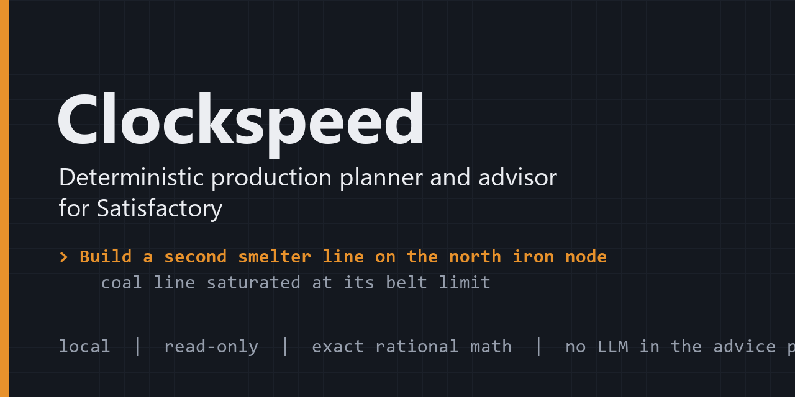
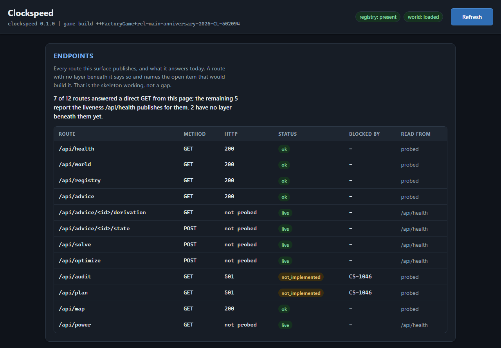

# Clockspeed



[](https://github.com/Remus3/ClockSpeed/actions/workflows/tier1.yml)
[](LICENSE)


**A local, deterministic production planner, ratio calculator and advisor for Satisfactory.**

Clockspeed reads the data files your own installation ships with and your own save file,
computes exact production mathematics, and tells you what to build next.

It carries no item, recipe or building dataset of its own. Every fact comes out of your
install at runtime, so the answer matches the patch you are actually playing rather than
whatever version a hand-maintained table was last updated against.

```
Build a second smelter line on the north iron node
  coal line saturated at its belt limit, upstream of the smelter bank
  [expand for the full derivation]
```

One line of instruction. One line of reason. The complete chain of reasoning one keystroke
away, generated from the rule trace rather than written by hand. The card above shows the
intended format; `/api/advice` serves cards in it today, and the dashboard does not draw
them yet - see Status.

## At a glance

| Property | |
|---|---|
| **Runs** | Entirely on your machine. No account, no API key, no network service. |
| **Reads** | Your game install and your newest save, both found automatically. |
| **Writes** | Nothing. Not to the install, not to a save. Ever. |
| **Arithmetic** | Exact rational. No floating point in the solve path. |
| **Language models** | None, anywhere in the advice path. |
| **Interface** | A local HTTPS dashboard, plus an optional Electron companion window. |

## Why

**It reads your install, not a wiki.** Community datasets and calculator sites drift from
the game with every patch. Clockspeed extracts items, recipes and buildings from the
shipped files at runtime, so a patch that changes a recipe changes the answer.

**It never writes.** Saves are copied to a work directory before parsing, so a running
autosave cannot be disturbed. This is an invariant covered by tests, not a promise in a
readme.

**It is reproducible.** Every recommendation is computed, ranked, explained and rendered
by deterministic rules. Two runs on the same save that disagree are a bug, and the full
derivation is generated from the rule trace rather than composed as prose.

**It is exact.** Ratios are solved in rational arithmetic and the solve path asserts that
no float reaches it, so a fractional building count is reported exactly rather than as a
rounded approximation.

**It is not a mod, a cheat, or an overlay into the running game.** Nothing is installed
into the game, no mod loader is required, and the game process is never injected into,
hooked or read from memory.

## Status

Pre-release, Windows only, under active development. `/api/health` reports the live route
table and what is wired to it; that endpoint is the authoritative answer to "what works
today", and this section is a summary of it.



*Rendered from the test suite's synthetic world - no real install or save is behind it.*

**Working today**

- **Target-rate ratio solve** (`/api/solve`). Ask for an output per minute and get the
  whole production tree: every intermediate, exact building counts, byproduct handling and
  raw input totals.
- **Alternate recipe selection under constraints** (`/api/optimize`). Pick the recipe set
  that minimizes raw resource use, power draw or building count over whichever recipe set
  you declare available; any other objective is refused rather than quietly ignored. For
  now the available set is supplied to the solver rather than read from your save.
- **Power and clock speed mathematics** (`/api/power`). Overclock and underclock cost
  curves, including the variable-power buildings whose draw is a bounded range.
- **Your world, read** (`/api/world`, `/api/registry`). The install and the most recent
  save are found on their own and the save is copied before parsing; header facts, world
  inventory counts and the normalized item and recipe registry are served.
- **A map of what you have built** (`/api/map`). Placements with exact translation,
  rotation and scale, read straight from the save file.
- **Advice cards** (`/api/advice`). Your world's cards with headline and one-line reason,
  each card's full derivation, and a per-world card state that refuses with 403 a request
  without the dashboard's same-origin header. The rules so far cover power headroom; the
  dashboard does not draw the cards yet. Without a save or a game install it answers 503.

**Built, not yet wired to the dashboard**

- **Whole-world audit.** Idle and starved machines with the upstream cause named, overclock
  waste, belt and pipe throughput saturation with the binding segment identified, power
  headroom and brownout risk, under-extracted resource nodes and extractor tier
  mismatches. The computation is written and tested, and the advice cards already read its
  power balance; `/api/audit` answers a documented 501 naming the work item that publishes it.

**Next:** milestone routing and the other advice domains - [`docs/ARCHITECTURE.md`](docs/ARCHITECTURE.md) section 4.

## How it works

```
 your game install            your save file (copied first, never opened in place)
        |                                |
  clockspeed/data/                clockspeed/save/
  locate, extract,                header, chunks, property
  normalized registry             mappings, world-state model
        |                                |
        +---------------+----------------+
                        |
                 clockspeed/solve/        exact ratios, recipe optimizer,
                        |                 power and clock math
           +------------+-------------+
           |                          |
   clockspeed/audit/          clockspeed/progress/
   whole-world audit          milestone routing
           |                          |
           +------------+-------------+
                        |
                clockspeed/advisor/       deterministic rules -> one-line cards
                        |                 with a trace-generated derivation
                clockspeed/surface/       local HTTPS API and dashboard
                        |                 (computes nothing)
                     shell/               optional Electron companion window
```

Each layer consumes only the layer below it through a stated model: the solver never reads
a save, the advisor never reads the raw game files, and the dashboard never computes. The
full module map and the seams are in [`docs/ARCHITECTURE.md`](docs/ARCHITECTURE.md).

## Your data stays yours

- You supply your own copy of the game. Clockspeed reads it where it is installed.
- Game data, extracted assets and save files are never redistributed and never committed
  to this repository. They belong to the game's publisher.
- Save headers carry personal data. The parsed header has no field for a save name, an
  options string or a session name; reading those takes a separate call with an explicit
  opt-in, and the object it returns withholds every value from `repr`.
- The test suite ships small hand-written synthetic data and runs on a machine with no
  game installed.

## Requirements

| Component | Needs |
|---|---|
| **OS** | Windows |
| **Game** | A local installation, kept current |
| **Python** | 3.13 or 3.14 - take the newest 3.14.x, not python.org's newest release when that is newer. The range is `requires-python` in [`pyproject.toml`](pyproject.toml); `scripts/verify_env.py` asserts its floor and prints the version it found |
| **git** | Git for Windows |
| **openssl** | For `scripts/make_cert.py`, and for the test suite. Git for Windows ships one, but not on PATH by default - [`docs/OPERATIONS.md`](docs/OPERATIONS.md#12-install-and-run-from-scratch) section 1.2 says how to add it; the suite needs more of Git's tools on PATH, as section 2 there states. `scripts/verify_env.py` reports it as SOFT |
| **Python packages** | The `dev` extra in `pyproject.toml`, installed by the Quickstart. Of it, `pytest` and `ruff` are the two `scripts/verify_env.py` counts as HARD |
| **Node** | For the optional companion window, and to run the full test suite - without Node the dashboard panel tests fail rather than skip. Running Clockspeed itself does not need it |

## Get the code

```
git clone https://github.com/Remus3/ClockSpeed.git
cd ClockSpeed
```

## Quickstart

From the root of a clone, in PowerShell - [`docs/OPERATIONS.md` 1.2](docs/OPERATIONS.md#12-install-and-run-from-scratch) has the full procedure, the `cmd` forms and where `<Git install>` is:

```
python -m venv .venv
Set-ExecutionPolicy -Scope Process -ExecutionPolicy RemoteSigned -Force
.venv\Scripts\activate
python -m pip install -e ".[dev]"
$env:Path += ";<Git install>\usr\bin"
```

```
python scripts/install_hooks.py
python scripts/verify_env.py
python scripts/make_cert.py
python -m clockspeed.surface
```

## First result

Open `https://localhost:<port>/`, where `<port>` is the `allocations` entry in
`config/ports.json` that `scripts/verify_env.py` prints. The certificate is self-signed and
your system does not trust it, so the browser shows a certificate warning to accept before
the page titled "Clockspeed dashboard" loads. `https://localhost:<port>/api/health` answers
a compact JSON object whose top-level `status` field is `ok`.

## How this repo is built

Clockspeed is developed with Claude Code agents, and these tracked files are the process
they follow: `CLAUDE.md` holds the rules they work under, `.claude/` their roles, commands
and settings, `ops/` the scripts that run queued work unattended and helpers the git hooks
and the test suite load, `.githooks/` those hooks, which the Quickstart installs, and
`CS-NEXT-SESSION.txt` the note one working session leaves for the next. Contributing needs
no Claude Code: start at `.github/CONTRIBUTING.md`, which sums up the rules a change must
keep; where it names a rule's owner file, that file governs. The product uses none of this.

## Documentation

| File | Covers |
|---|---|
| [`docs/ARCHITECTURE.md`](docs/ARCHITECTURE.md) | Module map, data flow, layer seams |
| [`docs/OPERATIONS.md`](docs/OPERATIONS.md) | Install from scratch, bootstrap, commands, runbooks |
| [`docs/adr/`](docs/adr/) | One file per architectural decision |
| [`ROADMAP.md`](ROADMAP.md) | Open work, one line per item |
| [`.github/CONTRIBUTING.md`](.github/CONTRIBUTING.md) | How to contribute, and the rules a change must keep |
| [`.github/SECURITY.md`](.github/SECURITY.md) | How to report a vulnerability privately |
| [`THIRD_PARTY.md`](THIRD_PARTY.md) | Vendored files and their licences |

## License

MIT - see [`LICENSE`](LICENSE). A small number of vendored files carry their own licence;
[`THIRD_PARTY.md`](THIRD_PARTY.md) lists each one.

Clockspeed is an independent project. It is not affiliated with, endorsed by, or connected
to Coffee Stain Studios. Satisfactory and its data files are the property of their
publisher; nothing extracted from a local installation is redistributed here.
